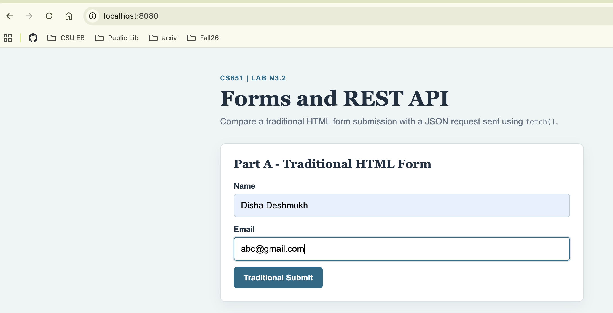
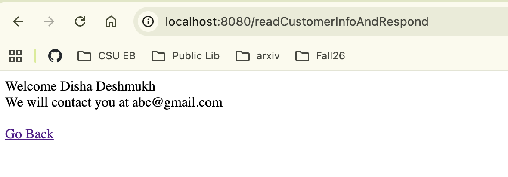
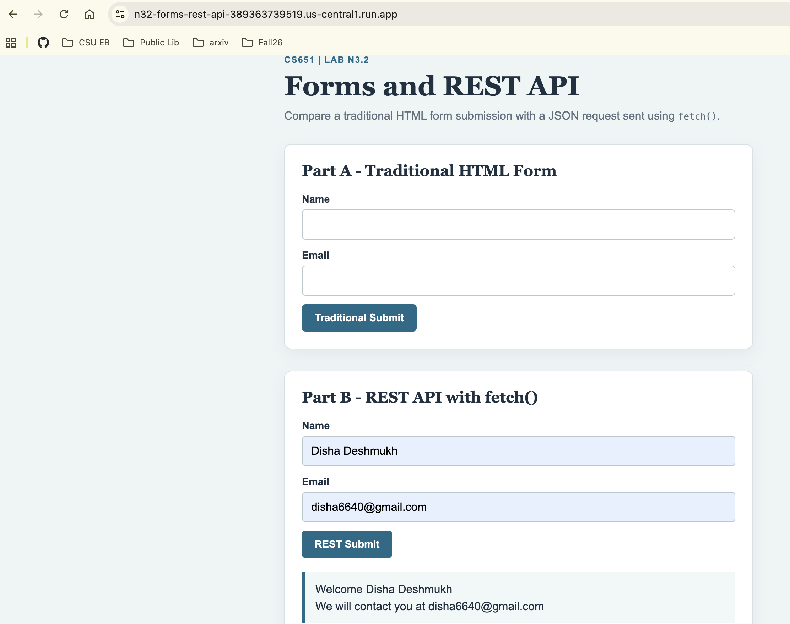
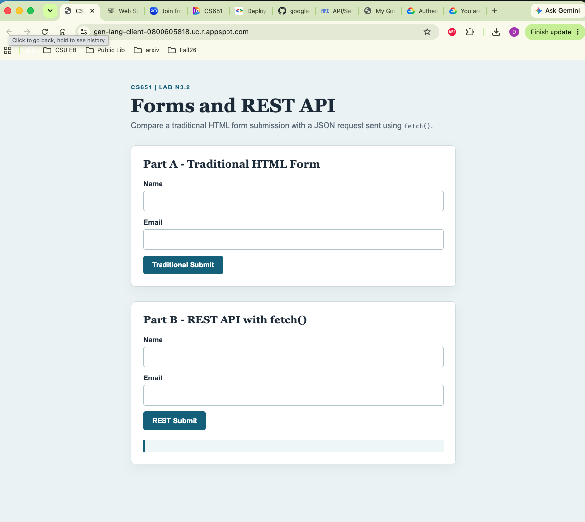
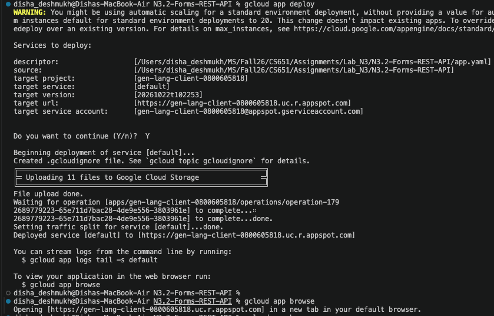
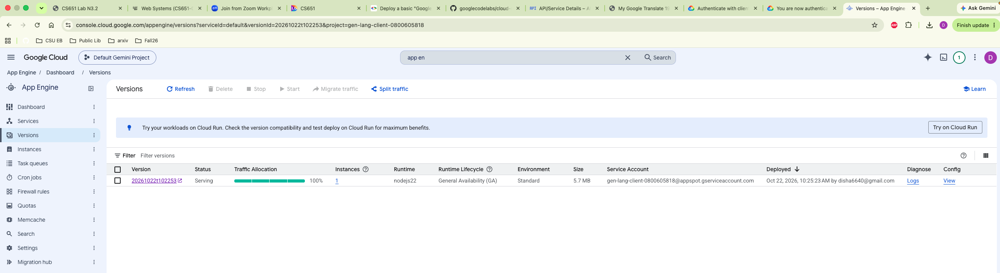

# CS651 Lab N3.2: Forms and REST API

This project demonstrates two ways to submit customer information from a web page:

- A traditional HTML form submitted with `POST`.
- A REST API request sent as JSON using `fetch()`.

## Run the Application

1. Install the dependencies:

   ```bash
   npm install
   ```

2. Start the server:

   ```bash
   npm start
   ```

3. Open [http://localhost:8080](http://localhost:8080) in a browser.

## Deploy to Google Cloud Run

This application can be deployed from the project directory using Google Cloud Run.

1. Open Terminal and enter the project folder:

   ```bash
   cd /Users/disha_deshmukh/MS/Fall26/CS651/Assignments/Lab_N3/N3.2-Forms-REST-API
   ```

2. Log in to Google Cloud and select the project:

   ```bash
   gcloud auth login
   gcloud config set project gen-lang-client-0800605818
   ```

3. Deploy the application:

   ```bash
   gcloud run deploy n32-forms-rest-api \
     --source . \
     --project gen-lang-client-0800605818 \
     --region us-central1 \
     --allow-unauthenticated
   ```

4. Open the service URL printed by the deployment command.

Cloud Run provides the port through the `PORT` environment variable, which this application uses automatically.

### Delete the Cloud Run Service

To terminate the deployed service:

```bash
gcloud run services delete n32-forms-rest-api \
  --project gen-lang-client-0800605818 \
  --region us-central1
```

## Application Sections

### Part A: Traditional HTML Form

The first form submits `name` and `email` to `/readCustomerInfoAndRespond` using a traditional form submission with the `POST` method. The server responds with a welcome message and a link back to the home page.

### Part B: REST API with `fetch()`

The second form sends the same fields as JSON to `/api/customer` using JavaScript. The response is displayed on the page without navigating away.

Example response:

```json
{
  "message": "Welcome Test User",
  "email": "test@example.com"
}
```

## Screenshots

### Traditional HTML Form



### Traditional Form Response



### REST API Response

.png>)

### Google Cloud Run Deployment



## Technologies

- Node.js
- Express
- HTML, CSS, and JavaScript

## Exercise G2.1: Google App Engine Deployment

The Node.js Express application was deployed to Google App Engine using the
Google Cloud CLI.

```bash
gcloud app deploy
gcloud app browse
```

GAE application URL:

<https://gen-lang-client-0800605818.uc.r.appspot.com>

### G2.1 Screenshots





